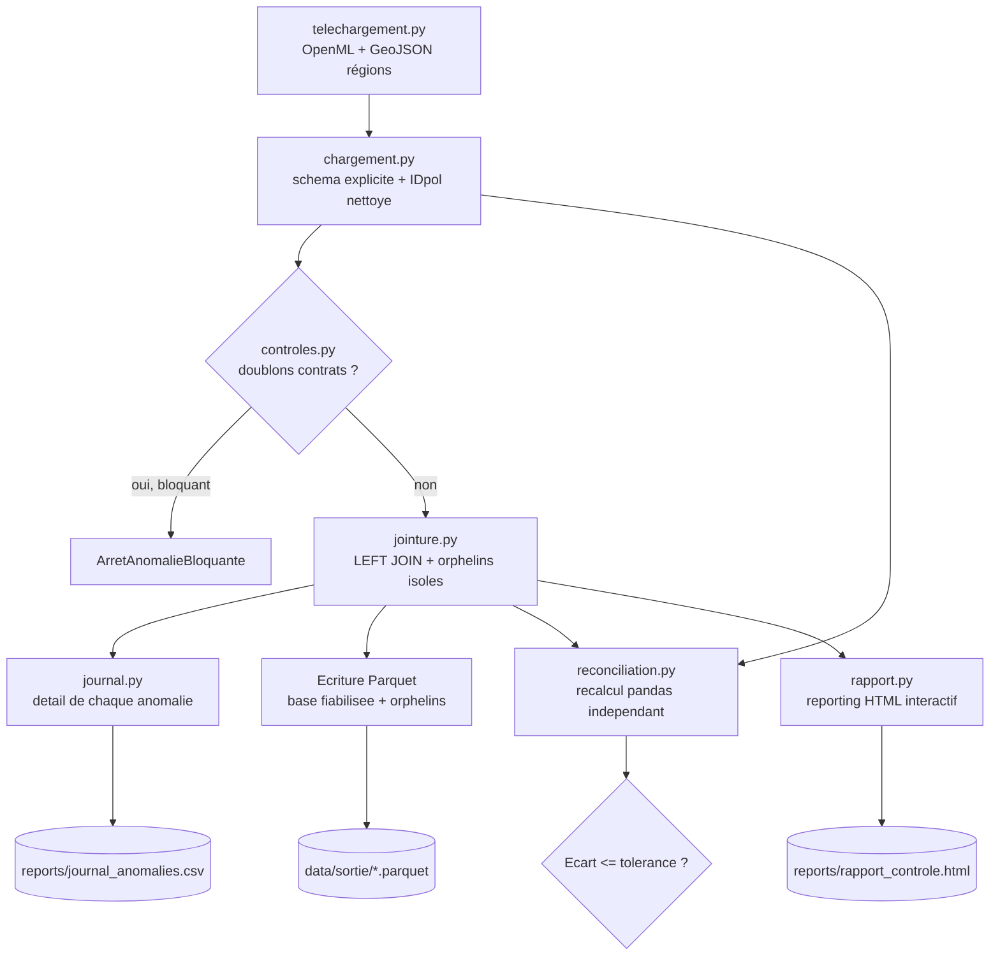
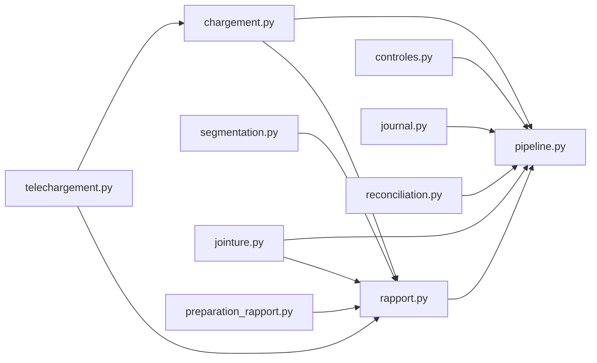

# Note de procédure — fiabilisation-donnees-auto

Cette note explique comment reproduire le traitement, ce que fait chaque
étape, et où trouver les livrables. Destinée à quelqu'un qui reprend le
projet sans son auteure (cf. cahier des charges, section 2).

## 1. Architecture du projet

### Arborescence

```
fiabilisation-donnees-auto/
├── config/
│   └── parametres.yaml          # ENF1 : toutes les valeurs (chemins, clés, seuils) — rien en dur dans src/
├── data/                         # non publié (.gitignore), régénéré par le pipeline
│   ├── brut/                     # CSV + GeoJSON téléchargés (OpenML, contours régions)
│   └── sortie/                   # base_fiabilisee.parquet, sinistres_orphelins.parquet
├── docs/
│   ├── Cahier des charges...md   # exigences du projet
│   └── note_procedure.md         # ce document
├── notebooks/
│   ├── data_analysis.ipynb       # exploration pas à pas (pédagogique), chaque décision expliquée
│   ├── analyse_descriptive.ipynb # analyse exploratoire hors périmètre officiel (fréquence, coût moyen...)
│   └── verif_spark_session.ipynb # vérification ponctuelle de l'environnement Spark
├── reports/                       # livrables générés : journal_anomalies.csv, rapport_controle.html
├── src/                           # code source, voir "Modules" ci-dessous
│   ├── telechargement.py
│   ├── chargement.py
│   ├── segmentation.py
│   ├── controles.py
│   ├── jointure.py
│   ├── journal.py
│   ├── reconciliation.py
│   ├── preparation_rapport.py
│   ├── rapport.py
│   └── pipeline.py               # point d'entrée (EF1)
├── tests/                         # un fichier de test par module src/, ENF3
├── AI_USAGE.md                     # traçabilité de l'usage de l'IA (ENF5)
├── pyproject.toml                  # dépendances + rend le projet installable (`pip install -e .`)
└── README.md
```

### Flux du pipeline (`python -m src.pipeline`)



### Dépendances entre modules `src/`



**Lecture** : `pipeline.py` est le seul point d'entrée (EF1) ; il orchestre
tous les autres modules mais n'est appelé par aucun d'eux. `rapport.py`
réutilise `chargement.py` et `jointure.py` (pas de duplication de la
lecture CSV ni de la logique de jointure). `controles.py` et `journal.py`
sont complémentaires : `controles.py` *compte* les anomalies (utilisé pour
la décision bloquant/alerte), `journal.py` *liste* chaque anomalie en détail
(utilisé pour la traçabilité EF3).

## 2. Installation (une seule fois)

Prérequis : Windows, Anaconda (environnement `actuary`), Python ≥ 3.11, Java
(pour Spark).

```powershell
conda activate actuary
pip install -e .
```

Installe le projet comme package local (`src/`) : les imports
(`from src.xxx import ...`) fonctionnent alors depuis n'importe quel
répertoire, sans manipuler `sys.path`.

Dépendances installées via `pip install -e .` (déclarées dans
`pyproject.toml`) : `pandas`, `scikit-learn`, `pyyaml`, `pyspark`, `plotly`,
`geopandas`.

**Note sur `geopandas`** : installé via `conda install -c conda-forge
geopandas` dans cette session plutôt que pip, pour éviter un conflit de
bibliothèque BLAS (voir section 7, limites connues).

Pour l'analyse exploratoire uniquement (`notebooks/analyse_descriptive.ipynb`,
hors périmètre officiel) : `pip install -e ".[analyse]"` (ajoute `seaborn`).

## 3. Lancer le traitement complet (EF1 : une seule commande)

```powershell
python -m src.pipeline
```

Depuis la racine du projet, avec l'environnement `actuary` activé. Ce
qui se passe, dans l'ordre (voir `src/pipeline.py`) :

1. **Téléchargement** (`src/telechargement.py`) : récupère `contrats.csv` et
   `sinistres.csv` depuis OpenML (IDs 41214/41215, via `sklearn.fetch_openml`,
   qui met en cache — relancer ne retélécharge pas). Récupère aussi le
   GeoJSON des régions françaises (contours pré-2015, utilisé par la carte
   du rapport).
2. **Chargement** (`src/chargement.py`) : lit les CSV avec un schéma Spark
   explicite (pas d'inférence automatique : déterministe, documente le
   contrat de données) et nettoie `IDpol` (passe de `"1.0"` à `"1"`, car une
   clé de police est un identifiant texte, pas un nombre).
3. **Contrôle bloquant** (`src/controles.py`) : vérifie l'absence de
   doublons de contrats *avant* la jointure. Si des doublons existent, le
   traitement s'arrête immédiatement (`AnomalieBloquante`) — c'est la seule
   anomalie classée "bloquant" dans `config/parametres.yaml`.
4. **Jointure** (`src/jointure.py`) : LEFT JOIN contrats ← sinistres agrégés
   par `IDpol`. Les sinistres orphelins (sans contrat correspondant) sont
   isolés dans une base à part, pas supprimés.
5. **Journal d'anomalies** (`src/journal.py`) : liste chaque anomalie
   individuellement (pas un simple total) — contrôle, identifiant (`IDpol`),
   valeur observée, niveau, date d'exécution.
6. **Écriture des livrables** : base fiabilisée et sinistres orphelins en
   Parquet (`data/sortie/`, non publiés — voir `.gitignore`), journal en CSV
   (`reports/journal_anomalies.csv`).
7. **Réconciliation indépendante** (`src/reconciliation.py`, EF6) : recalcule
   les totaux (nb contrats, exposition, nb sinistres, charge) directement en
   pandas à partir des CSV bruts, indépendamment de tout le traitement Spark,
   et compare à la tolérance définie dans le YAML (`tolerance_reconciliation`,
   1%). Le pipeline s'arrête avec un code d'erreur si un écart dépasse la
   tolérance.
8. **Reporting HTML** (`src/rapport.py`, EF5) : génère
   `reports/rapport_controle.html`, un tableau de bord interactif
   autonome (aucun serveur requis), lisible par un non-développeur.

Durée observée sur la machine de développement : quelques minutes (dominé
par le démarrage de Spark et le premier téléchargement OpenML ; les
exécutions suivantes sont plus rapides grâce aux caches).

## 4. Où sont les livrables

| Livrable | Chemin | Format |
| --- | --- | --- |
| Base fiabilisée | `data/sortie/base_fiabilisee.parquet` | Parquet (non publié, gitignored) |
| Sinistres orphelins | `data/sortie/sinistres_orphelins.parquet` | Parquet (non publié, gitignored) |
| Journal d'anomalies | `reports/journal_anomalies.csv` | CSV |
| Reporting HTML | `reports/rapport_controle.html` | HTML autonome |
| Données brutes téléchargées | `data/brut/*.csv`, `data/brut/regions_france.geojson` | CSV / GeoJSON (gitignored) |

## 5. Comment lire le journal d'anomalies

Chaque ligne = une anomalie individuelle, pas un total agrégé :

| Colonne | Signification |
| --- | --- |
| `controle` | Nom du contrôle (`doublons_contrats`, `doublons_sinistres`, `cles_orphelines`, `coherence_nb_sinistres`, `exposition_hors_bornes`) |
| `identifiant` | `IDpol` concerné |
| `valeur_observee` | La valeur qui a déclenché l'anomalie (ex: nombre d'occurrences, montant, ou `"ClaimNb=2;nb_sinistres_reel=0"`) |
| `niveau` | `bloquant` (arrête le traitement) ou `alerte` (journalisé, traitement continu) |
| `date_execution` | Horodatage ISO 8601 (UTC) de l'exécution |

Niveaux et seuils définis dans `config/parametres.yaml` (`controles.niveaux`,
`controles.exposition_min/max`), avec le raisonnement métier en commentaire
à côté de chaque valeur.

## 6. Contrôles appliqués et pourquoi, avec les hypothèses de Laurice

Résumé condensé (le détail complet est dans `notebooks/data_analysis.ipynb`
et `AI_USAGE.md`). Chaque hypothèse est attribuée : **Origine : Laurice**
(son idée/interprétation d'origine), **Origine : IA** (vérification ou
proposition), **Origine : Laurice + IA** (décision prise ensemble) — même
convention que dans les notebooks.

### Les 5 contrôles officiels du cahier des charges

- **Doublons de contrats** (bloquant) : un contrat dupliqué fausse
  directement les totaux — on ne peut pas se permettre de continuer.

- **Lignes de sinistres strictement dupliquées** (alerte) : deux lignes de
  `sinistres.csv` avec **exactement le même `IDpol` ET le même
  `ClaimAmount`** (au centime près). 241 groupes trouvés sur les vraies
  données (232 paires, 6 triplets, 2 groupes de 4, 1 groupe de 6 — soit 255
  lignes en excès au total).

  > **Origine : Laurice** — *"Les doublons sur les sinistres (255 lignes) ne
  > sont pas simplement « un contrat avec plusieurs sinistres » : ce
  > contrôle détecte des lignes strictement identiques (même IDpol ET même
  > ClaimAmount au centime près). [...] Ça peut venir d'un vrai doublon
  > d'enregistrement, ou d'un paiement fractionné en plusieurs tranches du
  > même montant — à investiguer."*

  Deux exemples réels pour illustrer les deux possibilités évoquées par
  Laurice :
  - `IDpol=64761` : exactement 2 lignes à `1128.12 €`, et **rien d'autre**
    pour ce contrat → ressemble à un vrai doublon d'enregistrement (la même
    ligne comptée deux fois à l'extraction).
  - `IDpol=2277846` : ce contrat a 66 lignes de sinistres au total (cas déjà
    repéré comme atypique), dont 2 valent `4000.00 €` chacune → ici, la
    coïncidence est plus plausible qu'un doublon : avec autant de sinistres
    sur un seul contrat, retomber deux fois sur un montant rond n'a rien
    d'anormal.

  **On ne peut pas trancher automatiquement entre les deux cas** sans
  information supplémentaire (ex: date du sinistre, numéro de sinistre)
  absente du jeu de données freMTPL2 — c'est pour ça que Laurice a choisi de
  garder ce contrôle en `alerte` (journalisé, pas supprimé) plutôt que de
  filtrer ces lignes, conformément à la règle du cahier des charges ("on
  signale et on documente, on ne répare pas sans règle écrite").

- **Clés orphelines** (alerte) : sinistre sans contrat correspondant.

  > **Origine : Laurice** — *"On a de vrais cas orphelins, certains contrats
  > qui ont des sinistres mais ne se retrouvent pas dans la base des
  > contrats, ceci peut être dû au fait que le contrat peut être rentré
  > tardivement ou juste déjà résilié."*

  195 lignes de sinistres concernées (6 polices distinctes), isolées dans
  `data/sortie/sinistres_orphelins.parquet` plutôt que supprimées —
  réutilisables lors du calage tarifaire des projets suivants.

- **Cohérence du nombre de sinistres** (alerte) : `ClaimNb` (déclaré) ne
  correspond pas à `nb_sinistres_reel` (recalculé).

  > **Origine : Laurice** — hypothèse formulée en observant le seul cas de
  > "vrai écart" (où `nb_sinistres_reel > 0`) : *"nb_sinistres_reel est un
  > sous-ensemble de ClaimNb"* — `ClaimNb` compterait tous les sinistres
  > déclarés, `nb_sinistres_reel` ne compterait que ceux dont le montant est
  > déjà connu.
  >
  > **Origine : IA** — vérifiée sur l'ensemble des 678013 contrats, pas
  > seulement ce cas isolé : `nb_sinistres_reel` ne dépasse jamais `ClaimNb`
  > (0 contre-exemple), ce qui confirme l'hypothèse.

  9117 contrats concernés, dont 9116 sont des cas où `ClaimNb > 0` mais
  aucun sinistre n'a été retrouvé (écart "silencieux", 0 € de charge
  associée) — un seul contrat a un vrai écart de comptage avec de l'argent
  réellement en jeu (543,33 €).

- **Exposition hors bornes** (alerte) : au-delà de 1 an.

  > **Origine : Laurice** — *"Exposition sup à 1 n'est pas forcément une
  > anomalie car on ne connaît pas exactement sur quelle période les
  > données sont récupérées. Mais pour effectuer des modèles de tarification
  > en introduisant la variable année, la contrainte d'exposition inf ou
  > égale à 1 est nécessaire — mais pour ce dataset je ne suis pas très sûre
  > à moins qu'on ait mentionné que l'exposition est annuelle, et je ne l'ai
  > pas vu."*

  1224 contrats concernés (0,18%) — défaut connu du jeu de données freMTPL2
  (la fiche officielle OpenML précise que les données sont *"observed
  mostly on one year"*, pas garanti à 100%), cohérent avec le doute exprimé
  par Laurice.

### Contrôles exploratoires hors périmètre officiel (BonusMalus)

Pas demandés par le cahier des charges, ajoutés pendant l'exploration
(`config/parametres.yaml`, bloc `controles.bonus_malus`) : bornes légales
(bloquant), non-multiple de 5 (alerte), jeune conducteur au plancher
(alerte). Décision explicite de Laurice sur le traitement de ces deux
dernières anomalies :

> **Origine : Laurice** — *"Pour les variables à retraiter, je ne sais pas
> trop quoi faire des 'jeune au plancher' (ton hypothèse de 13 ans n'est pas
> forcément vraie si ce n'est pas dans la loi ou la réglementation, donc pas
> de traitement je crois). Les bonus-malus qui ne sont pas multiples de 5,
> ce n'est pas forcément une anomalie, mais pas de traitement non plus."*

Autrement dit : ces deux signaux restent **journalisés mais non corrigés**,
car l'hypothèse qui les sous-tend (13 ans sans sinistre pour atteindre le
plancher) est une estimation de l'IA, pas une règle écrite ou réglementaire
— appliquer un traitement dessus violerait la règle du cahier des charges
("on ne répare pas sans règle écrite").

## 7. Tests

```powershell
python -m pytest tests/ -v
```

43 tests, aucun appel réseau (tous utilisent de petits DataFrames Spark en
mémoire ou des fichiers temporaires). Couvre : chargement/schéma,
contrôles, jointure, segmentation, préparation du rapport, journal
d'anomalies, réconciliation.

## 8. Limites connues

- **Écriture Parquet sur Windows** : `src/pipeline.py` écrit le Parquet via
  `pandas`/`pyarrow` plutôt que `DataFrame.write.parquet()` de Spark, car
  l'écriture native Spark nécessite `winutils.exe`/`HADOOP_HOME` (absent par
  défaut sur Windows). Tout le calcul reste en PySpark (ENF6) ; seule cette
  dernière étape d'écriture bascule en pandas.
- **Reporting HTML volumineux (~2 Mo)** : chaque graphique Plotly embarque
  ses données en JSON directement dans le fichier (pas de serveur, donc pas
  de chargement à la demande). La bibliothèque Plotly.js elle-même est
  chargée une fois via CDN (nécessite une connexion internet à l'ouverture).
- **Carte des régions** : utilise les 22 anciennes régions françaises
  (avant le redécoupage de 2015), car ce sont les codes utilisés par le
  dataset (`R11`...`R94`), pas les 13 régions actuelles.
- **Couleurs du rapport** : inspirées d'une capture d'écran de L'Olivier
  Assurance (demande explicite), pas une charte graphique officielle
  téléchargée — à ajuster si les vraies valeurs hexadécimales sont
  disponibles.
- **`src/pipeline.py` non testé automatiquement de bout en bout** :
  orchestration validée manuellement (voir ce document), mais pas par un
  test pytest dédié (nécessiterait de télécharger les vraies données dans
  la suite de tests, ce qu'on évite pour rester rapide et sans réseau).

## 9. Usage de l'IA

Voir [`AI_USAGE.md`](../AI_USAGE.md) à la racine du dépôt : trace ce qui a
été proposé par l'IA, ce qui a été décidé par Laurice, et la convention de
tag (**Origine : Laurice** / **Origine : IA** / **Origine : Laurice + IA**)
utilisée dans les notebooks.
